 <a href="https://arthur-babkin.vercel.app/cv-arthur-babkin-en.pdf"></a
><a href="https://t.me/theother_archeee"></a
><a href="https://arthur-babkin.vercel.app/en"></a
><a href="https://www.linkedin.com/in/arthur-babkin-19954632b/"></a
> <a href="https://arthur-babkin.vercel.app/en#experience"></a
><a href="https://arxiv.org/abs/2609.01572"></a
>   <a href="https://github.com/ArthurBabkin/Parimate"></a
> <a href="https://github.com/ArthurBabkin/ADMET_2024_Hackathon"></a
><a href="https://github.com/ArthurBabkin/stud_startup_bot"></a
>

